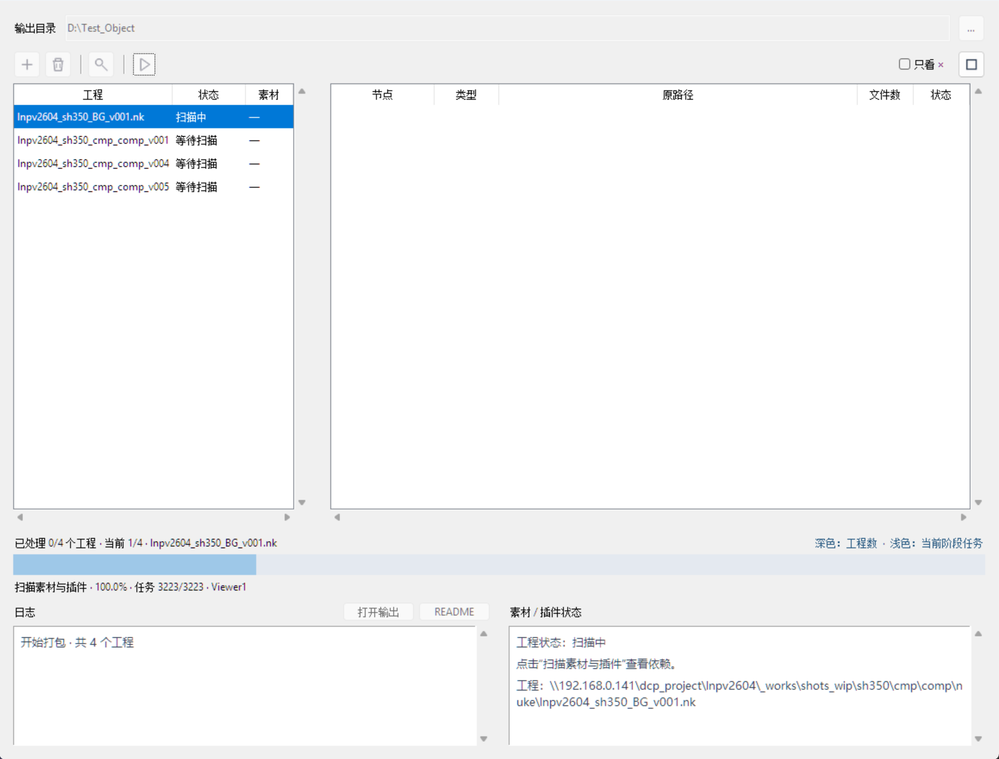

# WrapItUpISO

> Fuck Vendor Nuke Pack. One Click, No Bullshit.

**把 Nuke 工程、素材和 Gizmo 整理成一个方便交付的文件夹。**

支持批量处理 `.nk` 工程，自动收集素材、改写路径并生成交付清单。打包时无需安装或启动 Nuke，也不会修改源工程。

**[下载 Windows 版](https://github.com/AmazingiKe/Warp-Up-ISO/releases/latest)** · [查看所有版本](https://github.com/AmazingiKe/Warp-Up-ISO/releases) · [详细说明](docs/reference.md)



## 开始使用

从 Releases 的 **Assets** 下载 `WrapItUpISO 1.1.27.exe`，双击运行。单个 EXE 已包含运行环境，**无需安装 Python**。

1. **添加工程**：拖入 `.nk` 文件或文件夹，也可以点击 `+` 多选添加。
2. **扫描依赖**：点击放大镜，检查素材与插件状态；有问题时点击条目查看原因。
3. **选择位置**：设置输出目录，也可以把文件夹拖到“输出目录”输入框。
4. **开始打包**：点击三角形按钮。完成后点击“打开输出”或“README”查看交付结果。

扫描和打包会处理列表中的**全部工程**。支持取消，已完成的工程会保留。

## 会得到什么

每个工程生成一个独立文件夹，结构示例：

```text
shot_路径哈希/
├── shot.nk             打包后的工程，接收方打开这一份
├── shot_original.nk    保留原路径的工程副本，供对照
├── media/              按节点名称整理的素材
├── gizmos/             已收集的 Gizmo（如有）
├── README.md           素材与插件的打包结果
└── report.json         详细依赖记录与文件校验信息
```

**交付或移动时，请复制整个文件夹。** 打包完成后先查看包内 README，确认是否还有未收集的依赖。

## 插件怎么处理

| 类型 | 处理方式 |
| --- | --- |
| Gizmo 及嵌套依赖 | 自动查找并收集，支持绝对路径引用 |
| RSMB、Frischluft 等 OFX / 二进制插件 | 不打包，接收方自行安装兼容版本并配置授权 |
| Python / Tcl 按钮、回调 | 保留原代码；无法确认的动态依赖提示核对 |
| 未找到的 Gizmo | 保留引用并记录到报告，默认继续打包其他内容 |

无法解析的 Gizmo、直接执行的外部脚本命令和文件校验失败等问题仍会阻止该工程打包；具体原因见状态详情。

## 接收方怎么打开

使用配置好外部插件的 Nuke 打开包内原文件名对应的 `.nk`，不要用 `_original.nk` 作为迁移后的工程。

如果包内有已收集的 Gizmo，先在 Nuke 的 **Script Editor → Python** 中执行以下代码，把路径换成实际位置：

```python
import nuke
nuke.pluginAddPath(r"D:/交付包/gizmos")
```

再打开工程。交付包不提供一键启动 Nuke 的脚本。

打包完成不代表渲染已经验收：缺失素材、动态路径、脚本依赖和隐式色彩配置仍需核对，最终效果请在 Nuke 中检查。目前支持 `.nk`，不支持 `.nknc` / `.nkple`。

## 更多说明

[详细使用与技术说明](docs/reference.md)包含快捷操作、素材收集规则、插件搜索方式、命令行用法，以及源码运行、EXE 构建和测试方法。
